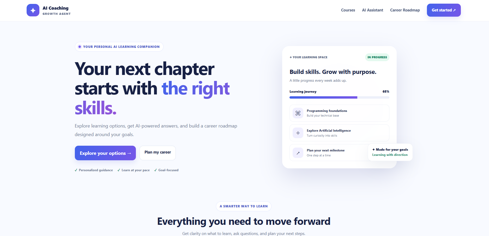
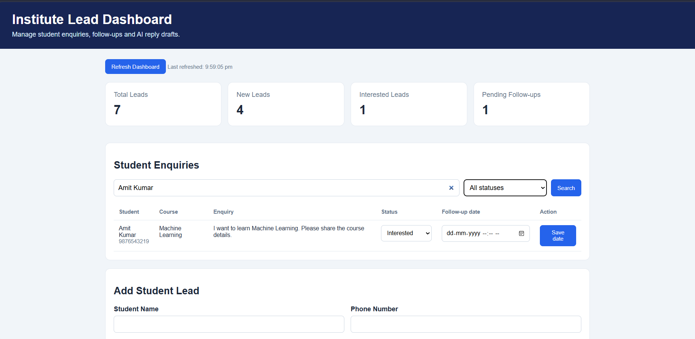

# AI Coaching Growth Agent

An AI-powered application that helps students explore courses and receive career guidance while helping coaching institutes manage student enquiries.

## Features

- AI-powered career guidance using the Gemini API
- Course search
- Learning roadmaps and resources
- Student lead management
- Lead status tracking
- Follow-up scheduling
- AI-generated reply drafts
- Institute dashboard


## Application Screenshots

### Student Website

Students can explore courses and access AI-powered career guidance.



### Institute Dashboard

The dashboard helps manage student leads, track statuses, and schedule follow-ups.




## Technology Stack

- Python
- FastAPI
- SQLite
- Gemini API
- HTML, CSS, JavaScript

## Run Locally

### 1. Clone the repository

```bash
git clone https://github.com/suvitkumarsourav/ai-coaching-growth-agent.git
cd ai-coaching-growth-agent
```

### 2. Create and activate a virtual environment

```powershell
python -m venv .venv
.\.venv\Scripts\Activate.ps1
```

### 3. Install dependencies

```bash
pip install -r requirements.txt
```

### 4. Configure the API key

Create a `.env` file in the project root. Add your Gemini API key using the environment variable name required by the application.

Never upload `.env` or expose your API key on GitHub.

### 5. Start the application

```bash
uvicorn app.main:app --reload
```

### 6. Open in your browser

- Student Website: http://127.0.0.1:8000/
- Institute Dashboard: http://127.0.0.1:8000/dashboard
- API Documentation: http://127.0.0.1:8000/docs

## Run Tests

```bash
python -m pytest app/test_api.py -v
```

## Author

Suvit Kumar Sourav

GitHub: https://github.com/suvitkumarsourav
